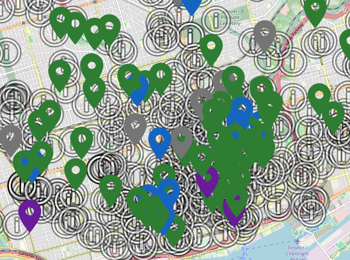

# OSM Field Notes - Changelog

## Version 1.2.24 (2026-10-03)

**Compass and whole city**: "compass does not work well. see notes has radius, let's also give option to show all in current city -- is this implementable?" (compass: wrong after rotating the map; city: yes, a fixed one)

- **The map's compass now points at the map's north and turns the map back to north up when you tap it.** osmdroid's `CompassOverlay` drew the phone's sensor heading and ignored a two-finger rotation, so after one it showed a north the map no longer had. A mini button top right follows the map's own orientation (from a draw-only overlay, the one hook that sees gestures and animations alike), shows only while the map is turned, and animates back to 0°. The orientation-sensor listener is gone with it. Verified hidden at north up on an emulator; the twist itself needs a phone.
- **Fetch area can now be the whole city you are in, so every open note and fixme in it is on the map and in the list.**  Settings' "Fetch radius" row is now "Fetch area" with a fifth choice, "Whole city…": one Nominatim reverse lookup at city zoom where you stand (else the map centre) names the boundary relation, you confirm "Fetch all of Toronto?", and the city is stored fixed (`PreferencesManager.fetchCity`) until you pick a radius or look up again. Notes come from `notes.json` over the city's bounding box with the API's maximum limit (10000), fixmes from an Overpass area query on the relation (`map_to_area`, 90 s timeout); notes therefore include the slices of neighbours inside the box, fixmes follow the boundary. Walking never refetches a city; it refreshes hourly, and switching radius, city or between cities is its own reason, via an area key now saved with each fetch centre (older centres read back as their radius). Expiry and the in-range filter take an area predicate instead of a radius (`PoiRepository.expireOutside`, `storeFetchedNotes(page, inArea, truncated)`). Lookups refuse a place that is not a boundary relation or whose box is over the notes API's 25 square degrees.
   Checked on an emulator at Toronto: 326 notes and 797 fixmes, 1123 pins drawn; city-view panning ran at a median 18 ms and 90th percentile 34 ms per frame there, so no marker culling yet; category marker icons are now shared instead of loaded per pin. PRIVACY.md and the listing name Nominatim.
- Tests: `CityLookupTest` (a real Toronto answer, node/error/oversized refusals), five city cases in `NearbyFetcherTest` (no position needed, walking vs hourly staleness, area switches, box expiry, legacy centres), two box-fetch cases in `OsmNotesServiceHttpTest`; 145 pass.

## Version 1.2.23 (2026-09-26)

**Name workshop**: "lets workshop the project name", then "rename what you can"
The app is now OSM Field Notes. Round one put eight directions on the table, round two narrowed to the finalists "OSM Field Notes" and "OSM Notes Nearby"; both were clear of collisions on Play, F-Droid, GitHub and the OSM wiki, and "OSM field notes" turned out to be plain survey vocabulary nobody has claimed (Field Papers is the only near neighbour). Field Notes won as a category of activity, with the nearby ping moved into the store tagline. Renamed: the launcher label, welcome string, notification title and permission dialogs, `Constants.APP_NAME`, `rootProject.name` (`OSMFieldNotes`), the three User-Agents and their test (`OSMFieldNotes/<version>`), the OAuth redirect scheme (`osmfieldnotes://oauth/callback`, in the manifest, gradle default, docs and example properties; no client was registered yet so nothing breaks), the keystore file name, alias and CN in FIRST_RUN and the example properties (no keystore exists yet), the GitHub repo (`gh repo rename OSMFieldNotes`, remote updated, the four privacy-policy URLs follow; the old URL redirects), and every doc, script banner and the listing (short description now leads with the ping). README and CLAUDE.md lose the stale `survey-me` clone lines. `copy-to-dropbox.ps1` resolves the APK from `$PSScriptRoot` so it survives the folder rename, which is left to the maintainer. Unchanged, as in item 15: package id `com.surveyme`, Kotlin packages and `SurveyMe*` classes, FileProvider authority, on-device file names, old changelog entries and roadmap item 15.

## Version 1.2.22 (2026-09-25)

**Roadmap item 17**: "build it as far as you can" (tests around the loop)
`OsmNotesServiceHttpTest` runs the notes client against an OkHttp `MockWebServer` (new test dependency, same 4.12.0): the bbox fetch asks `/api/0.6/notes.json` with `closed=7`, `limit=500` and a square that brackets the point and parses the sample collection into `OsmNote`s; comment / close / reopen post a form `text` with the Bearer token to `notes/{id}/{action}.json` (empty body when blank); create posts `lat`, `lon`, `text` as query parameters with no Authorization header when anonymous; 429 surfaces as `FetchHttpException(429, retryAfterSeconds)`, 401 and 409 keep the server's plain-text reason, an HTML body is dropped, and a non-note 200 is an `IOException`. `NearbyFetcherTest` drives the real `NearbyFetcher` (clock now injectable, default unchanged) over Robolectric SharedPreferences and mocked services through every gate: never fetched, the 0,0 sentinel, under and over half the radius, the 60 s minimum interval, 15 min staleness, the item 13 changed-radius reason, MANUAL and MAP_LOAD, backoff doubling per source with Retry-After winning and the 30 min cap, MANUAL never jumping a backoff, reset after a success, `wantsRefetch` while backing off, and the circle filter on the square's corners. `ProximityDetectorTest` (clock injectable too) covers ping-once, the five-minute cooldown, the visited set and reset, the item 13 radius for notes and fixmes against a waypoint's own, the inclusive boundary and `getProximityPois`; the "barely moved" and coarse-fix gates were already tested in `LocationCadenceTest`, and the classifier-against-corpus test existed since item 8. `app/src/androidTest/.../DeepLinkTest.kt` (androidx.test runner and rules added) stores a POI, launches MainActivity with the exact intent `showPoiNotification` builds and asserts the Notes tab is selected and the details sheet shows the item's title, retrying for up to 10 s because the deep link reads Room off the main looper; it compiles (`assembleDebugAndroidTest`) but has not run on a device. `run-tests.ps1` now sums the JUnit XML into a one-line count with the names of failed cases.

## Version 1.2.21 (2026-09-25)

**Roadmap item 16**: "build it as far as you can" (release prep)
The launcher icon is now a real adaptive icon: a hand-drawn map pin with an orange "fixme" exclamation mark on a flat `#1976D2` background, with a monochrome layer for Android 13 themed icons and a layer-list fallback in `res/mipmap/` for API 23 to 25 (there were no PNG mipmaps to delete; the same vector still feeds the splash). `PRIVACY.md` in the repo root covers background location, the OSM token (encrypted prefs, `write_notes read_prefs`, logout and revoke), exactly which servers see what (bounding boxes, tiles, User-Agent), evidence, backups, no analytics, and deletion; it is linked from README and from a new "Privacy policy" row under Settings > About that opens `Constants.PRIVACY_POLICY_URL` on GitHub. `assembleRelease` built clean at the baseline already; `proguard-rules.pro` now spells out the Gson signature, Parcelable / Serializable, Tink, OkHttp / okio, osmdroid and coroutines rules (a blanket Tink keep was tried and dropped, it cost 450 KB), so the unsigned release APK is 3.6 MB against 10.5 MB debug. `build.gradle.kts` reads `RELEASE_STORE_FILE / _STORE_PASSWORD / _KEY_ALIAS / _KEY_PASSWORD` from local.properties or the environment and signs only when the store exists, `*.jks / *.keystore / *.p12` are gitignored, FIRST_RUN.md has the exact keytool command, and `RELEASE.md`, `store/listing.md` (title, 72-character short description, Play-style full description, categories, content-rating and data-safety notes) and `store/screenshots/README.md` (the six screens still to capture) round it off. The manifest also loses the `WRITE_EXTERNAL_STORAGE` (maxSdk 28) permission that nothing in the code used, so the policy can say "no storage permission" truthfully. The signing wiring was exercised once with a throwaway PKCS12 keystore passed through environment variables (signed `app-release.apk`, key password defaulting to the store password), then deleted. Still owed by the maintainer: the keystore, the six screenshots, and the license decision (MIT vs GPL-3.0, untouched here), which RELEASE.md lists as a publishing blocker.

## Version 1.2.20 (2026-09-25)

**Roadmap item 15**: "build it as far as you can" (rename)
The launcher label, the welcome string, the foreground-service notification title and the two permission dialogs now say FixMeAwesome instead of Survey Me, `rootProject.name` is `FixMeAwesome`, and README, FIRST_RUN, app-description, the changelog heading, CLAUDE.md and the build-and-install script banners follow; older changelog entries, the roadmap history and `design/` keep the old name as history. Deliberately unchanged: the package id `com.surveyme`, the Kotlin package and class names (`SurveyMeApplication`, `SurveyMeDatabase`, `Theme.SurveyMe`), the `fixmeawesome://oauth/callback` redirect, the FileProvider authority, and every on-device file name (`surveyme_database`, `survey_me_preferences`, `osm_auth.xml`, `app_log.txt`, `crash_log.txt`), so existing installs keep their data.

## Version 1.2.19 (2026-09-25)

**Roadmap item 14**: "build it as far as you can" (battery pass)
The tracking service now asks fused location for fixes at a cadence that follows the walker: `LocationCadence` (`core/`, pure, unit-tested) picks stationary (60 s, balanced power, 20 m), walking (10 s, high accuracy, 5 m) or fast (5 s, high accuracy) from the provider's speed or distance over time, switches up on the first faster fix and down only after two fixes and 30 s (2 min for stationary), a 30 s ticker treats two minutes without any fix as stationary, since the walking tier's displacement filter delivers nothing to a walker who stopped, a derived move shorter than the fix accuracy counts as standing still (a wifi jump on the bench must not switch the GPS on), and a fix older than 30 s (the echo of the last known one after a re-request) is dropped before anything sees it; the request is re-issued only on a tier change, each logged as one `Cadence:` line. The proximity pass is skipped when the fix moved under 3 m from the last one checked (unless a minute passed) or is coarser than twice the ping radius, the per-fix per-POI distance dump is gone, the ongoing notification refreshes every 30 s instead of every fix, and `FileLoggingTree` no longer writes verbose lines. Walker refetches launch at most once a minute and never while one runs (notes and fixmes were already one call under one mutex); there was no wake lock before, and the only one now is a 45 s-capped partial lock held just for that fetch (`WAKE_LOCK` permission added). The Notes tab was the GPS-in-the-background offender, not the map: its own `LocationManager` listener (5 s / 2 m, removed only in `onDestroyView`) now runs only between onResume and onPause, at 10 s / 5 m, and not at all while the service tracks, whose fixes feed the list instead; `MapFragment` already stopped its overlay in onPause. `TrackingStats` (fixes, proximity passes, fetches, pings, tier changes, tier, battery at start and now) is a StateFlow shown as a "Battery stats" row in Settings and logged as a `Battery:` line every 10 min and at stop. No schema change. The two-hour walk measurement itself still needs a device.

## Version 1.2.18 (2026-09-25)

**Roadmap item 13**: "build it as far as you can" (settings for the loop)
Settings gets a "Pings and fetching" card of plain Material widgets bound to `PreferencesManager`: fetch radius (1 / 2 / 3 / 5 km, default 2; `NearbyFetcher.fetch` defaults to it, the expiry uses the same value, the refetch trigger stays "moved more than half the radius" and a changed radius is its own refetch reason), ping radius (25 / 50 / 100 / 200 m, default 50, applied by `ProximityDetector` to notes and fixmes while imported waypoints keep their own), "Notes that ping" checkboxes (Surveyor on, Telemapper / JOSM / Unclassified off; `NotePingPolicy` now takes the class set through a `PingSettings` value, with stale and future `#surveyafter` still never pinging), Mute notes / Mute fixmes master switches that gate the ping flow only, quiet hours (switch plus 24-hour `MaterialTimePicker`s, default 22:00 to 07:00, pure `QuietHours` window with a wrap past midnight; the service skips the detector inside the window so nothing is marked notified, and fetches continue), and the item 12 fixme age as a third door to the same pref. Every loop write bumps a process-wide `PreferencesManager.loopSettingsTick` that the repository's ping flow and the Notes tab combine with, so a change is felt without a database write or a restart. A "Muted items (N)" row opens a new list of every `isMuted` note and fixme (pending-create placeholders excluded, they are muted by design) with kind, first line, distance, an Unmute button with Undo, Unmute all, and a tap into the details sheet. Unit tests cover the quiet-hours window (incl. the wrap and equal bounds) and the class-set and mute gates. No schema change. Nothing here has run on a device yet.

## Version 1.2.17 (2026-09-25)

**Roadmap item 12**: "build it as far as you can" (fixme list quality)
A fixme row in the Notes tab now leads with the `fixme` text and carries the element's main tags underneath (name, then the first of amenity / shop / highway / building / leisure / natural / tourism / office / craft / man_made / railway / public_transport, plus a node/way marker) and "Edited <date> · vN" from Overpass `out meta` (`lastEditedAt`, DB v9 with a real ALTER TABLE migration, schema 9.json exported). `FixmeClassifier` (`core/FixmeRules.kt`, pure, unit-tested on a dozen phrases) labels the text `continue`, `resurvey`, `check_name`, `check_position` and `check_tags` into a new `labels` column, shown as chips in the row and the details sheet; existing rows get labels from the first-launch reclassify pass (`NoteClassifier.VERSION` 2) and their edit date on the next Overpass fetch. Fixmes on relations are dropped (the query never asked for them; the parser and the list both drop one anyway), a "Fixme age" submenu in the Notes tab overflow (Any / 1 / 2 / 5 years, `PreferencesManager.fixmeMaxAge` for item 13) hides older ones from the list and the ping gate (`NotePingPolicy.mayPing(poi, note, now, maxAge)`, applied on the next database emission), swiping a fixme row dismisses it for now with an Undo snackbar (the same `isMuted` flag as the details chip), and dismissed fixmes sink to the bottom of the list. Nothing here has run on a device yet.

## Version 1.2.16 (2026-09-25)

**Roadmap item 11**: "build it as far as you can" (evidence capture)
The details sheet gets an Evidence row with "Add photo" (`TakePicture` into `files/evidence/` through a new FileProvider, no storage or camera permission declared), "Pick photo" (`PickVisualMedia`, copied into the same dir) and "Add text" chips; each capture snaps the walker's fix and writes an `evidence` row (DB v8, create-only migration, schema 8.json exported) keyed by POI id with a snapshot of the item's title, first line, source and coordinates, and on purpose without a foreign key so the row outlives the POI's refetch expiry; evidence pinned to a queued-create placeholder is re-keyed when osm.org answers. Pinned rows render at the end of the sheet with EXIF-rotated, `inSampleSize`-decoded thumbnails (a tap opens the photo via ACTION_VIEW), and a "To review" screen from a Home card ("N to review") lists everything newest first with Open item (details sheet, or the snapshot in a dialog once the POI is gone), Reviewed / Not reviewed, Share (ACTION_SEND with the JPEG or the text) and Delete (row, then file), plus a "Show reviewed" switch. `EvidenceSnapshot` (`core/`, unit-tested) holds the summary and sample-size maths. The camera round-trip, picker and viewers are verified against the contracts' source, not yet on a device.

## Version 1.2.15 (2026-09-25)

**Roadmap item 10**: "build it as far as you can" (fixme hand-off)
The POI row now carries the OSM element behind a fixme as columns (`osmElementType`, `osmElementId`, `osmElementVersion` from Overpass `out meta`; DB v7, with the existing `overpass_{type}_{id}` ids split into the new columns by the migration itself, schema 7.json exported), and `OsmElementRef` (`core/`, unit-tested) parses ids and note text and builds the URLs. Fixme details get a "Fix in editor" chip row: osm.org, Edit online (`/edit?type=id`), Vespucci when installed (an explicit-package `http://127.0.0.1:8111/load_and_zoom?...&select=node123` intent, which its manifest and RemoteControlUrlActivity accept), StreetComplete when installed (a `geo:` intent, the only scheme it registers) and "Open map here" (`geo:` chooser); a `<queries>` block gives Android 11+ visibility. Any editor tap marks the fixme visited and a "Dismiss for now" chip sets `isMuted` (the flag the service actually filters pings on), leaving the row dimmed as "FIXME · DISMISSED" with an undo; a note whose thread links an osm.org element gets the same chips for that element. Editor intents are verified against source, not yet on a device.

## Version 1.2.14 (2026-09-25)

**Roadmap item 9**: "build it as far as you can" (morning triage)
A `Triage` screen, reached from a "Morning triage: N new notes" card on Home and a toolbar action on the Notes tab, lists the stored open notes created after the last triage stamp (`lastTriageAt` in prefs, everything before the first Done), newest first, each with its first line, author and date, the item 8 label chips, and assist chips `#surveyme`, `#surveyafter…` (Material date picker, future dates only, posts `#surveyafter YYYY-MM-DD`), `#armchair` and `#josm`, the heuristic guess filled in its audience colour so the tap is a confirmation; a tap needs a login (otherwise a dialog points to Settings and nothing is posted) and queues the tag as a comment through item 6's offline queue, after which the row shows "Pending: #tag" until osm.org's answer reclassifies the note (verified: `storeNoteFromServer` runs the classifier). Notes already carrying a strict tag show "Tagged #x" with a Change chip; Skip or a swipe hides a row for the session; a "Show all open notes" switch lifts the stamp filter; Done, or the first tag posted, stamps the time the screen was opened so notes fetched later with a newer date come up next time. The filter and guess live in pure `NoteTriage` (`core/`) with unit tests; no schema change (one new `note_actions` query). Untested against osm.org like items 5 to 7.

## Version 1.2.13 (2026-09-25)

**Roadmap item 8**: "build it as far as you can" (note classification)
`NoteClassifier` (pure Kotlin, `core/`) ports every rule of `analysis/classify_notes.py`: topics on the boilerplate-stripped opening comment, survey requests, app reports (StreetComplete, Organic Maps, CoMaps, EveryDoor) split into "observed, needs edit" and "needs ground check", element/photo/source links, anonymous, discussed, stale, low signal, mine, note to self, loose future dates as a `future_dated` hint only, and duplicate clusters (same author, day, first four words, within the prototype's 600 m) computed in the repository over the fetched batch plus what is stored; strict tags `#surveyme` / `#resurvey`, `#surveyafter YYYY-MM[-DD]` (`scheduled` until the date, with the date persisted in `surveyAfter`), `#armchair` and `#josm` replace the heuristic audience. Labels are recomputed on every store (fetch, post answer, create placeholder), once for all stored rows on the first launch after this build (a `classifier_version` pref), and after a login or logout for `mine`. `NotePingPolicy` decides what pings: fixmes as before, notes only when open, surveyor-class, not stale and past their `#surveyafter` date (checked against the clock on each emission), so telemapper- and JOSM-only notes stay silent. The Notes tab gets an All / Surveyor / Telemapper / JOSM chip row persisted in prefs (fixmes show under All and Surveyor), lists notes that would ping now first and then by distance, marks them "NOTE · PINGS", and shows up to four label chips per row with all of them in the details header; map note markers are pins tinted by audience (green surveyor, blue telemapper, purple JOSM, grey none). Unit tests cover the rules, the ping policy and the 305-note corpus (`app/src/test/resources`), where the port reproduces the prototype's counts exactly (surveyor 180, telemapper 102, JOSM 93 vs 94).

## Version 1.2.12 (2026-09-25)

**Roadmap item 7**: "build it as far as you can" (create a note)
A new note can be composed where you stand (a FAB on the Map tab and a "Create note here" button on Home, from the tracking service's fix or the platform's last known one) or at a long-press on the map, which first confirms the coordinates; the dialog shows "Posting as <name>" or, logged out, "Posting anonymously" and then asks "Post anonymously?" once with a way to the login, and Post is disabled while the text is blank. The note goes into item 6's `note_actions` queue as a `create` row (DB v6: nullable `lat`/`lon` added with ALTER TABLE, schema 6.json exported) and is shown at once as a muted placeholder with a negative id ("NOTE · PENDING" in the list, an upload marker on the map, no actions or osm.org link in details, protected from refetch expiry); `POST /api/0.6/notes.json?lat=&lon=&text=` is sent with the Bearer token when there is one, anonymously only if the note was composed while logged out, and on success the server's note replaces the placeholder under its real id, muted and marked visited so it cannot ping its author (the DB `isVisited` flag is not what the detector gates on; `isMuted` is), while a hard refusal drops the placeholder with the reason and first line of the text in a toast. Nothing has been posted to osm.org yet: the whole path is untested until the maintainer registers an OAuth client or tries an anonymous create.

## Version 1.2.11 (2026-09-25)

**Roadmap item 6**: "build it as far as you can" (comment, close, reopen)
The note details sheet now posts comments, closes and reopens with the logged-in user's token: Comment opens a text dialog with Send, Close and Reopen take an optional comment, and an open note shows Comment + Close while a closed one shows Reopen. Every action is written first to a `note_actions` queue table (DB v5, create-only migration) and applied optimistically (a "pending" thread row, "N actions pending" in the header, status flipped locally for close/reopen); `NoteActionQueue` drains it oldest-first on app start, when a network with internet appears, after login and after each post, replacing the stored note with the server's answer on success, backing off (30 s to 10 min, Retry-After honoured) on network trouble, 429 and 5xx, and on any other 4xx dropping the row, refreshing the note from osm.org and toasting the server's text; a 401 also clears the login. `OsmNotesService` now uses the OAuth base URL for fetches too, so a dev-server token never reaches production. Nothing has been posted to osm.org yet: the whole path is untested until the maintainer registers an OAuth client.

## Version 1.2.10 (2026-09-25)

**Roadmap item 5**: "build it as far as you can" (OSM login)
`OsmAuthManager` runs OAuth 2.0 Authorization Code with PKCE (S256, public client, scopes `write_notes read_prefs`) against `/oauth2/authorize` and `/oauth2/token`, opens the authorize page in a Chrome Custom Tab and returns through a `fixmeawesome://oauth/callback` intent-filter on MainActivity; the token, display name and uid (from `user/details.json`) live in EncryptedSharedPreferences, excluded from backup. Settings has an account card ("Logged in as ..." with Log out, or "Log in to OpenStreetMap"), and the note details action row now follows real login state (posting itself is item 6). The client id is read from `local.properties` (`OSM_OAUTH_CLIENT_ID`, see `local.properties.example`); no client is registered yet, so the whole flow is untested against osm.org until the maintainer registers one, and without an id the login button says so instead of launching.

## Version 1.2.9 (2026-09-25)

**Roadmap item 4**: "build it as far as you can" (note details rework)
The details sheet now takes the full screen and renders a note's thread as a RecyclerView of comments, each with author (or "Anonymous"), action (opened / commented / closed / reopened), a relative date within the last week or a short absolute one, and the text; bare close and reopen entries get a row, empty plain comments do not. The header shows an Open / Closed / Hidden status pill, created and closed dates, reply count and the distance from the walker (from the list, or from the last known fix when opened from a ping or marker). "Open on osm.org" links to the note page, or to the element page for a fixme whose `overpass_{type}_{id}` id is derivable; fixmes show their fixme text and raw tags as key/value rows, and "Show on map" still round-trips to the map. A comment / close / reopen action row is laid out but hidden until OSM login (item 5) and posting (item 6) exist.

## Version 1.2.8 (2026-09-25)

**Roadmap item 3**: "build it as far as you can" (first-class note model)
Notes now have their own `osm_notes` table (DB v4, real migration): note id, status, created and closed dates, the comment thread as structured entries (date, author or null for anonymous, uid, action, text), plus `labels` and `surveyAfter` reserved for classification. The POI row stays the thing on the map and keeps its ping flags. The parser reads the real notes.json date format (the old ISO pattern silently fell back to "now"), keeps closed notes, and a refetch drops in-radius notes the API no longer returns unless they were closed within 7 days; closed notes are excluded from proximity pings. The Notes tab and details sheet show status, close date and reply count from the structured data; the full thread rendering is item 4.

## Version 1.2.7 (2026-09-25)

**Roadmap item 2**: "build it as far as you can" (fetch follows the walker)
All note and fixme fetching now goes through one `NearbyFetcher`: the tracking service refetches around the walker once they are more than 1 km (half the 2 km radius) from the last fetch centre or the last fetch is older than 15 min, and rows of that source outside the radius are expired after each successful fetch, keeping muted, visited and last-ping flags on the survivors. osm.org and Overpass each get their own gate with a 60 s minimum interval and exponential backoff (2 min doubling to 30 min, honouring Retry-After) on HTTP or network failure; two fetches never overlap. Map load and the Settings button use the same path, the map now fetches fixmes too, and the Settings toast reports per-source counts or the skip reason. While tracking, the map tab does not fetch and the Settings button fetches around the walker, so a stale map position cannot expire the walker's set.

## Version 1.2.6 (2026-09-25)

**Roadmap item 1**: "go" (ping opens the item)
The proximity notification now deep-links to the note or fixme details in the Notes tab and carries a "Mute this one" action. Muted is a new `isMuted` column (DB v3); refetching notes keeps muted, visited and last-ping flags instead of wiping them. Notification title says "Note nearby" or "Fixme nearby" with the distance and first line of text.

## Version 1.2.5 (2026-09-24)

**Roadmap item 0**: "continue yes" (fixmes actually reach the list)
Fixme POIs are now saved with source `osm_fixme` so the Notes tab query finds them. Rows left by earlier builds under source `overpass` are deleted on map load and before each Settings fetch.

## Version 1.2.4 (2026-03-15)

**Phase 8**: Database Setup (Room) - "implement"
Added TrackEntity, LocationPointEntity, TrackDao, database migration, and backup utility to lay the groundwork for track persistence.

## Version 1.2.3 (2025-09-18)

**Toronto Data**: "read file from data_samples folder"
Integrated 20 Toronto Bike Share stations as default POI data loaded from JSON on app launch.

## Version 1.2.2 (2025-09-18)

**Phase 13**: Proximity Detection - "notifications are not sent"
Fixed Android 13+ notification permissions and added runtime permission request.

**Phase 12**: POI Display on Map
Added POI markers to map with category icons and auto-insertion of sample data.

**Phase 10-11**: POI System Foundation
Created Room database for POIs with GPX import support and type converters.

**GPS Tools**: "create gps walker"
Built PowerShell GPS simulators with WASD controls for testing without physical movement.

**Build System**: Automation setup
Created build-install.ps1 script and fixed gradle-wrapper.jar issue.

**Bug Fixes**: App crash on fragment destroy
Fixed NullPointerException in MapFragment and added missing manifest permissions.